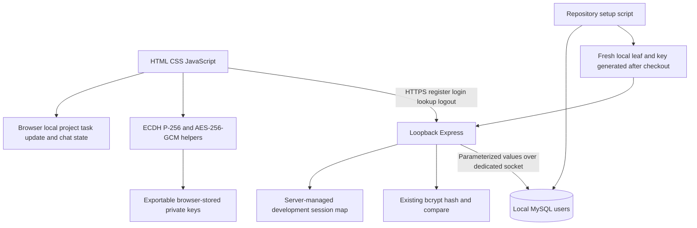

# UniCollab architecture

The setup script replaces dependence on private workstation infrastructure; it does not alter application business logic. Users persist in MySQL, while projects/tasks/updates/chat remain local to a browser. Two identities can share that state for a local walkthrough; independent-client synchronization is not implemented. `sql/users.sql` is the complete relevant user DDL; fictional users are created by the UI/tests. New sessions are portfolio-only and not per-project production authorization.
