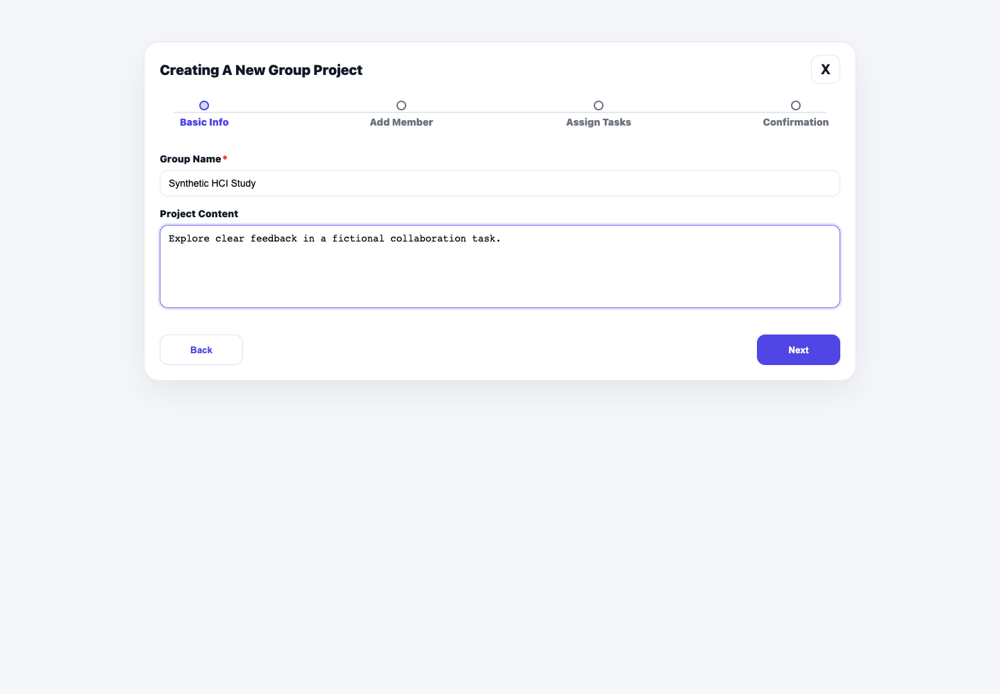
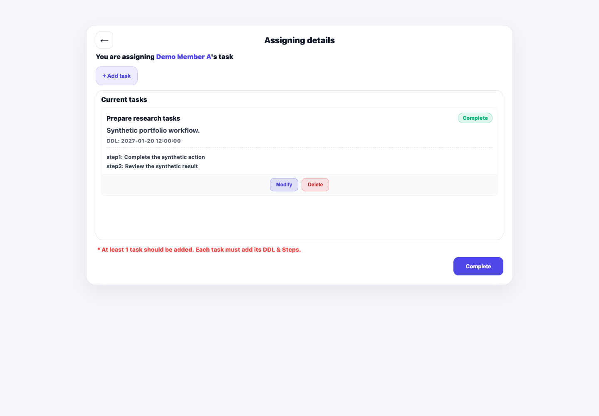
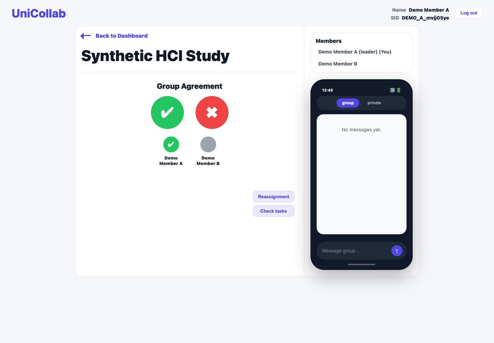
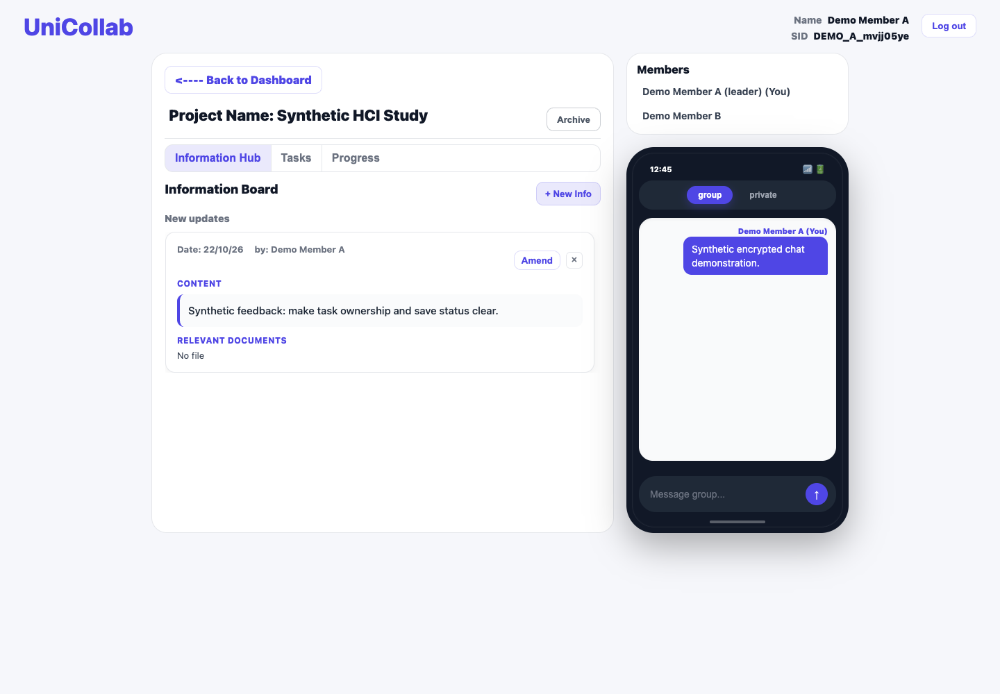

# UniCollab — Student Collaboration Platform

A team coursework prototype combining interview-led interaction design, frontend implementation and security-aware development for student group coordination.

## Motivation

Group work involves shared responsibilities, deadlines and changing information. UniCollab explores how task ownership, group agreement, progress and shared updates can make coordination easier to understand.

## My contribution

In Semester 1, 2026, I led project conception and development coordination, designed the UI/interactions and Lo-Fi/Hi-Fi prototypes, and implemented the frontend screens apart from chat. I conducted at least five interviews and three think-aloud sessions and contributed feedback-driven UI/backend improvements. I also worked on bcrypt password salting/hashing and parameterized user-account queries. This was collaborative INFO2222 coursework at the University of Sydney; the chat interface and shared team implementation are not claimed as my sole work.

## Design and implementation process

Problem identification → interviews → Lo-Fi/Hi-Fi design → UI implementation → think-aloud evaluation → feedback-driven improvements → security-aware development.

Feedback-informed priorities included confirmation before consequential actions such as archiving, clearer indication of older Information Board content, and newest-first updates. The current implementation confirms project archiving and inserts new updates at the beginning of the list. The proposed visibility/scroll cue is a design recommendation, not a separately verified completed change. No measured before/after usability improvement is claimed.

Counts describe my interview and think-aloud sessions, not a verified number of distinct participants or the whole team's sample. Original sketches, raw participant records and full assessment reports are not bundled. Synthetic feedback in the screenshots is demonstration data, not a participant quote.

## Implemented functionality and stack

- Staged project setup, registered-member lookup and task assignment with deadlines/steps.
- Group agreement, workspace information updates and task/progress views.
- Express/MySQL user registration/login with bcrypt salted password hashing.
- Browser ECDH P-256/AES-256-GCM message helpers.
- A contained HTTPS walkthrough with server-managed local sessions and mutation-Origin protection.

HTML/CSS/JavaScript, Node.js/Express, MySQL/mysql2, bcrypt, Web Crypto and TLS. Accounts persist in MySQL; project/task/update/chat state remains local to one browser. See [architecture](ARCHITECTURE.md) and [security notes](SECURITY_REVIEW.md).

## Screenshots

Genuine prepared-application captures with fictional members, tasks and feedback. The chat shown is shared team functionality, not my frontend authorship claim.









## Coursework and later portfolio work

The bcrypt implementation was developed during coursework, temporarily commented for a security demonstration and inadvertently left disabled. Portfolio preparation restored that existing implementation. It did not invent password hashing for this project. Later sessions, socket containment, generated local TLS/setup and integration/test repairs are portfolio work. [Contribution history](CONTRIBUTIONS.md) and the [HCI case study](HCI_CASE_STUDY.md) provide context.

## Run locally

Prerequisites: Node.js 22+, installed MySQL (`mysqld`), OpenSSL supporting `-addext` and runtime dependencies from the lockfile. The existing local verification reused offline dependencies; a clean lockfile installation has not yet been verified for UniCollab.

```sh
npm ci
npm run demo:init
npm start
```

The `npm ci` line is the dependency-provisioning command, not an additional claimed test result. Setup creates a new private networking-disabled MySQL instance, local configuration and fresh development TLS files; it refuses existing `.local` or `.env`. It never selects the former course service. See [local setup](LOCAL_SETUP.md) for executable selection, certificate warnings, restart and stop commands.

Open `https://127.0.0.1:8443/login.html`. Register two fictional accounts. Create a project, add the second member, assign both members a task with deadline/steps and confirm. Sign in as the second identity to agree, then return to the first identity's workspace. Both identities share browser-local project storage; this is not independent-device synchronization.

## Verification and limitations

Twelve automated TLS/MySQL/API/browser checks passed for hash storage/login, access rejection, the project/task/agreement workflow, updates, progress, encrypted-message rendering and logout. [Testing](TESTING.md) and [results](TEST_RESULTS.md) define the scope. These are software checks, not a new human-participant study.

Password hashing, TLS transport and browser message encryption are different mechanisms. No whole-database encryption, comprehensive SQL-injection prevention or production E2EE is claimed. Private keys are exportable into browser storage; independent-client key distribution/synchronization and production project authorization are not implemented. Input, rate limiting, XSS and dependency review remain incomplete. This is a local coursework prototype.

## Team and attribution

Collaborative University of Sydney INFO2222 project, Semester 1, 2026, with historical AI/tool assistance acknowledged. The team is credited collectively; individual contributions above sit alongside shared implementation, including chat. Restored original bcrypt and later portfolio-only infrastructure must be credited separately. No blanket public license is applied; raw research records, full reports, keys and runtime credentials are excluded.
